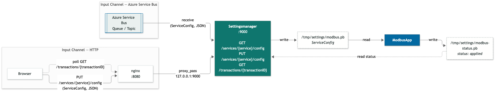
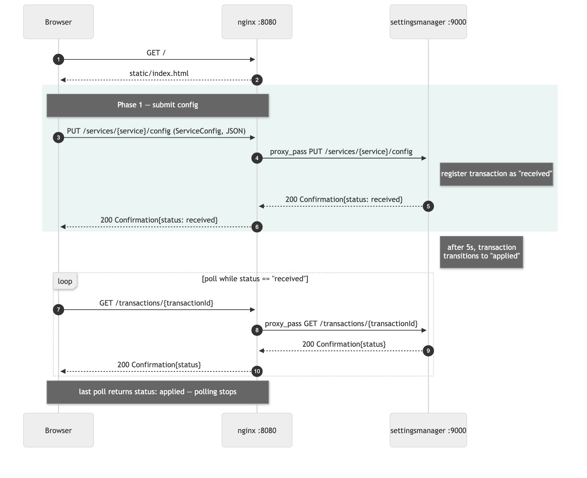

# settingsmanager-ngnix

Statische Seite (nginx) mit Formular für eine `ServiceConfig`, die
als JSON per Reverse Proxy an den
`settingsmanager`-Service weitergeleitet wird. Der Service ist nicht
Teil dieses Projekts und muss separat laufen.

## Architektur

```
Browser  --GET /----------------------------------> nginx :8080 --> static/index.html
Browser  --GET /services/{service}/config----------> nginx :8080 --> settingsmanager :9000/services/{service}/config
Browser  --PUT /services/{service}/config----------> nginx :8080 --> settingsmanager :9000/services/{service}/config
Browser  --GET /transactions/{transactionId}-------> nginx :8080 --> settingsmanager :9000/transactions/{transactionId}
```

Komponentenübersicht mit beiden Input-Channels und der
dateibasierten Übergabe an die `ModbusApp`:



Der Azure-Service-Bus-Channel und die `ModbusApp` sind nicht Teil
dieses Projekts; das Diagramm zeigt sie zur Einordnung mit.
Quelle des Diagramms: [`docs/component-diagram.mmd`](docs/component-diagram.mmd)
(Mermaid, gerendert mit `@mermaid-js/mermaid-cli`).

Sämtliche Nutzdaten sind JSON: der Browser schickt eine
`ServiceConfig` (mit der `ModbusConfig` im `details`-Feld) als
`application/json` per `PUT` an `/services/{service}/config`.
Der Service im Pfad kommt aus dem Eingabefeld der Seite (im
Beispiel `modbus`). Der
`settingsmanager`-Service registriert die Transaktion und antwortet
sofort mit einer `Confirmation{status: received}`. Der Browser
zeigt die Antwort an und pollt danach im Sekundentakt
`/transactions/{transactionId}`, bis `settingsmanager` den
Status nach 5 Sekunden intern auf `applied` gesetzt hat.

Sequenzdiagramm des Ablaufs:



## Voraussetzungen

- nginx
  - macOS: `brew install nginx`
  - Arch/Omarchy: `sudo pacman -S nginx`
- Go >= 1.26

## Starten

1. Settingsmanager-Service separat starten. Er muss auf
   `127.0.0.1:9000` lauschen.

2. nginx mit der Projekt-Config starten:

   ```
   mkdir -p logs/tmp
   nginx -p $(pwd) -c nginx/nginx.conf
   ```

   Lauscht auf `127.0.0.1:8080`. `logs/tmp` muss vorher existieren,
   da `nginx.conf` dort projektlokale Temp-Verzeichnisse anlegt
   (Distro-Pakete wie unter Arch/Omarchy verwenden sonst
   `/var/lib/nginx` bzw. `/var/log/nginx`, die ohne root nicht
   beschreibbar sind).

3. Seite öffnen: http://127.0.0.1:8080

   Das Textfeld startet leer. Ablauf ist GET → bearbeiten → PUT:

   - **GET** holt mit `GET /services/{service}/config` die Config,
     die der `settingsmanager` aktuell für den Service hält, und
     schreibt sie ins Textfeld. Der Service kommt aus dem
     Eingabefeld darüber (Default `modbus`) und bildet den
     Pfadsegment-Teil beider Endpunkte.
   - **PUT** schickt den Inhalt des Textfelds als
     `ServiceConfig`-JSON per `PUT` an
     `/services/{service}/config` und zeigt die
     `Confirmation`-Antwort darunter an.

   Beide Male stempelt die Seite eine frische `transaction_id` in
   die Payload, damit jedes PUT eine neue Transaktion ist statt
   die ID der zuletzt angewendeten wiederzuverwenden.

   Hat der `settingsmanager` für den Service noch nichts
   gespeichert, antwortet GET mit `404 Not Found`.

## Stoppen

```
nginx -p $(pwd) -c nginx/nginx.conf -s stop
```

Den settingsmanager-Service separat beenden.
